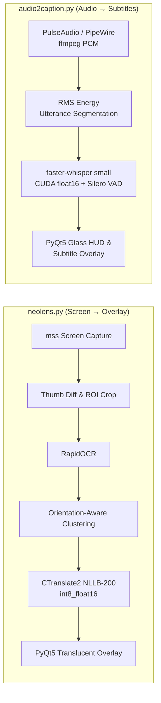

<div align="center">

# NeoLens — Open Real-Time Screen & Audio Translator

[](https://www.python.org/)
[](#)
[](https://developer.nvidia.com/cuda-toolkit)
[](LICENSE)

*100% local, GPU-accelerated screen/manga OCR translation and live desktop-audio subtitle translation into English.*

**Platform Support:** **Linux (X11)** — tested on Linux Mint and Ubuntu with NVIDIA CUDA.


</div>

---

## ✨ Overview

**NeoLens** (`open-realtime-translator`) packages two standalone, low-latency, completely offline desktop translation tools for Linux X11:

> [!IMPORTANT]
> Run **`neolens.py`** and **`audio2caption.py`** **one at a time, not simultaneously**, to avoid GPU VRAM contention and overlapping bottom subtitle bars.

### 1. Visual Screen & Manga Translator (`neolens.py`)
- **Sub-500ms Local GPU Pipeline:** Combines `mss` screen capture, `RapidOCR`, and `CTranslate2` (`NLLB-200-distilled-600M` quantized to `int8_float16`) with automatic 25% resolution scaling (`↓25%`) whenever frame latency exceeds the 500 ms SLA cap.
- **Language Support:** Translates `JA` (Japanese), `KO` (Korean), `ZH` (Chinese), and `RU` (Russian) directly into English (`-> EN`).
- **3 Adaptive Presets:**
  - **🎬 Movie / Sub** (`≤ 150 ms` budget) — Targets the lower subtitle band with greedy decoding (`beam_size=1`), docked translation boxes above original subtitles, and anti-flicker debounce.
  - **⚡ Fast Read** (`≤ 320 ms` budget) — Balanced full-screen scanning for games, web UIs, and general reading.
  - **🔍 HQ Manga** (`≤ 500 ms` budget) — High-resolution (`1920px`) detection, vertical right-to-left speech-bubble clustering, and beam search (`beam_size=2`).
- **Glass HUD & Ergonomics:**
  - **Dual-Subtitle (`A/文`):** Toggle between English-only and bilingual (`Original + English`) overlays.
  - **Peek Ghost Mode (`👁 Peek`):** Drop overlay opacity to 15% via the `👁 Peek` button, holding `Alt`, or right-clicking the HUD.
  - **Mouse-Wheel Font Scaling:** Scroll anywhere on the HUD to scale overlay font size (`70% – 160%`).
  - **Area Selection (`🎯 Area`):** Drag a custom ROI rectangle, force rescan with `Ctrl+Shift+Alt` / `⚡ Scan`, or copy translated batches (`📋 Copy`).

### 2. Live Desktop Audio Translator (`audio2caption.py`)
- **Real-Time System Audio Capture:** Taps directly into your default PulseAudio / PipeWire sink monitor (`pactl get-default-sink`) via low-latency `ffmpeg` PCM streaming (`16 kHz`, mono).
- **Energy-Based Utterance Segmentation:** Splits speech cleanly on natural pauses (`0.30 s` silence) or at the quietest frame within `2.8 s` chunks, dropping stale queued audio to stay strictly real-time.
- **Whisper CUDA Translation:** Runs `faster-whisper` (`small`, `float16` on CUDA) with Silero VAD and log-prob / no-speech filtering to translate `KO / JA / ZH / RU -> EN`.
- **Synchronized PyQt5 Glass HUD & Subtitle Overlay:** Shares NeoLens's draggable dark-glass HUD (`KO / JA / ZH / RU`, `👁 Peek`, `📋 Copy`, `Pause`, live latency readout, and mouse-wheel font scaling) paired with a click-through translucent bottom subtitle pill.

---

## 🧠 Architecture



---

## 📁 Repository Layout

```text
open-realtime-translator/
├── neolens.py            # Visual translator: Linux X11 real-time screen/manga OCR + CTranslate2 NLLB-200
├── audio2caption.py      # Audio translator: Live desktop-audio subtitle translator (PulseAudio/PipeWire + faster-whisper)
├── requirements.txt      # Pip dependencies
├── LICENSE               # MIT License (Copyright (c) 2026 Bui Minh Hoang)
├── .gitignore            # Ignore models, venv, caches, and binaries
├── assets/               # Screenshots directory (with .gitkeep)
└── README.md             # Full English documentation
```

---

## 🛠️ Setup (3 Steps)

### Step 1: Install System Packages (Ubuntu / Linux Mint / Debian)
```bash
sudo apt update
sudo apt install -y ffmpeg pulseaudio-utils python3-venv
```
> **Notes:**
> - **Display Server:** NeoLens targets **Linux (X11)** (`QT_QPA_PLATFORM=xcb`) for transparent click-through overlays and global hotkeys.
> - **CUDA:** An NVIDIA GPU with CUDA 12 runtime libraries (`libcudart`, `libcublas`, `libcudnn`) is recommended for sub-500ms `neolens.py` performance and required for `audio2caption.py` (`float16` on CUDA).

### Step 2: Create Virtual Environment & Install Pip Dependencies
```bash
git clone https://github.com/<your-username>/open-realtime-translator.git
cd open-realtime-translator

python3 -m venv .venv && source .venv/bin/activate && pip install -r requirements.txt
```

### Step 3: Launch NeoLens or Audio2Caption

Run **one** tool at a time inside the activated `.venv`:

**Visual Screen & Manga Translator (for on-screen text, games, UIs, and manga):**
```bash
python3 neolens.py
```

**Live Desktop Audio Translator (for raw audio/streams without subtitles):**
```bash
python3 audio2caption.py
```

**Optional — Headless Latency Benchmark (`1920×1080` synthetic frame across all presets):**
```bash
python3 neolens.py --benchmark
```

> **First-Run Model Downloads:**
> - **`neolens.py`** automatically downloads `entai2965/nllb-200-distilled-600M-ctranslate2` and the `facebook/nllb-200-distilled-600M` tokenizer into `models/nllb-200-ct2/` on first run.
> - **`audio2caption.py`** automatically downloads the `faster-whisper` `small` model into your local Hugging Face cache.

---

## 🗺️ Roadmap & Contributions Welcome

Contributions, bug reports, and pull requests are welcome! Planned improvements include:
- **Wayland Support:** Native Wayland layer-shell / portal capture support alongside Linux X11.
- **RapidOCR CUDA Tuning:** Direct TensorRT / ONNX Runtime CUDA ExecutionProvider optimization for even lower OCR latency.
- **Auto-Bubble Segmentation:** Improved manga speech-bubble contour detection and masking for stylized and angled typography.
- **Cross-Platform Windows Port:** Desktop audio capture via WASAPI loopback and transparent click-through overlays using Win32 window flags.

---

## 📄 License

Released under the [MIT License](LICENSE) © 2026 **Bui Minh Hoang**.
